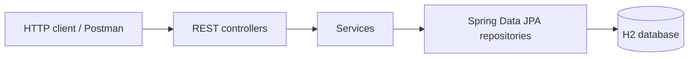
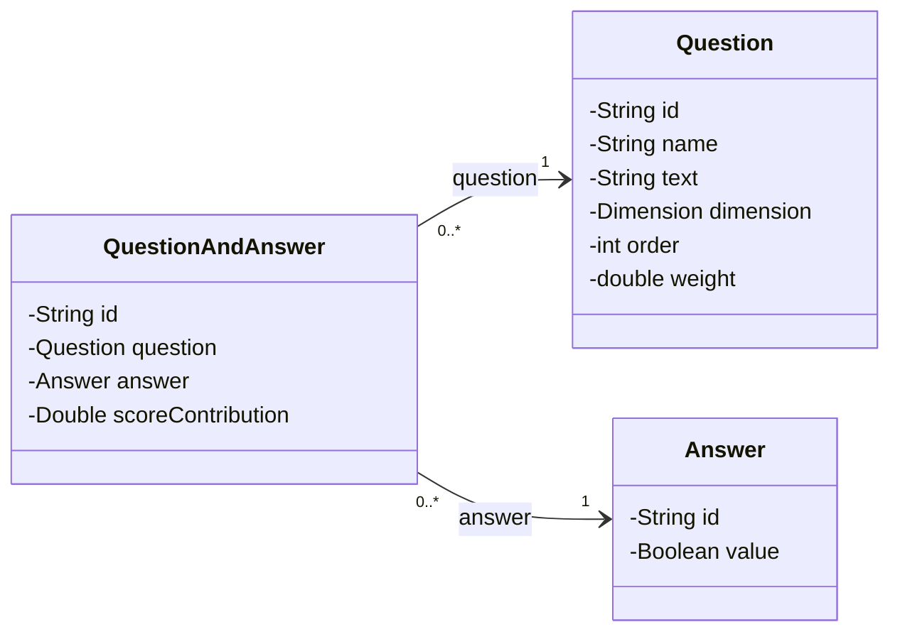

# compassMap

[](https://adoptium.net/)
[](https://spring.io/projects/spring-boot)
[](https://spring.io/projects/spring-data-jpa)
[](https://www.h2database.com/)
[](https://maven.apache.org/)

**compassMap** is a Spring Boot backend that helps learners identify their current
programming profile and receive a learning roadmap tailored to it.

A customer answers a short questionnaire. Each answer contributes a score to a
`Dimension` (for example, prior coding experience or willingness to learn). The
resulting score profile is mapped to a `CodeProfile` (beginner, architect,
non-developer, ...), which recommends a `RoadMap` with the next learning steps.

> This repository is the **v2** milestone: the flat v1 model is being evolved into a
> relational JPA model. The project is backend-only: entities, repositories,
> services and REST controllers. No frontend is part of the v2 scope.

---

## Table of contents

- [Project status](#project-status)
- [Features](#features)
- [Architecture](#architecture)
- [Data model](#data-model)
- [Tech stack](#tech-stack)
- [Project structure](#project-structure)
- [Getting started](#getting-started)
- [REST API](#rest-api)
- [Postman collection](#postman-collection)
- [JPA design decisions](#jpa-design-decisions)
- [Tests](#tests)
- [Documentation](#documentation)
- [Roadmap](#roadmap)
- [Author and acknowledgements](#author-and-acknowledgements)

---

## Project status

| Milestone | Scope | Status |
|---|---|---|
| v1 | Flat entities, repositories and REST CRUD over H2 | Done |
| v2 / Task 1 | `QuestionAndAnswer` linked to `Question` and `Answer` via `@ManyToOne` | **Done** |
| v2 / Task 2 | `CustomerProfile` linked to `Customer` (`@OneToOne`) and `RoadMap` (`@ManyToOne`) | Planned |
| v2 / Task 3 | `AssessmentView` as an aggregate of `Customer`, `List<QuestionAndAnswer>` and `CustomerProfile` | Planned |

The current branch is `task1-qanda`. Each v2 task is developed on its own branch.

---

## Features

- CRUD REST API for customers, profiles, questions, answers, Q&A rows and roadmaps.
- Relational model with explicit foreign keys (`question_id`, `answer_id`, ...).
- `QuestionAndAnswer` as the join entity between the question catalogue and the
  answer catalogue, with a `scoreContribution`.
- Request validation with meaningful `400 Bad Request` responses and `404 Not Found`
  for missing resources.
- H2 database with Hibernate schema generation (`ddl-auto=update`).
- Maven Wrapper, so no global Maven installation is required.
- Postman collection with 15 executable requests and assertions.
- Mermaid diagrams and a JPA walkthrough in `docs/`.

---

## Architecture

Classic layered Spring Boot application:



| Layer | Responsibility | Package |
|---|---|---|
| Controller | HTTP routes, request/response bodies, status codes | `com.example.demo.controller` |
| DTO | Explicit request contracts, decoupled from entities | `com.example.demo.dto` |
| Service | Business logic, FK resolution, partial updates | `com.example.demo.service` |
| Repository | Persistence and derived queries | `com.example.demo.repository` |
| Model | JPA entities and enums | `com.example.demo.model` |
| Exception | Central mapping from exceptions to HTTP responses | `com.example.demo.exception` |

---

## Data model



`QuestionAndAnswer` is the **owning side**: the table `question_and_answer` stores
the foreign keys `question_id` and `answer_id`. Both associations are
**unidirectional `@ManyToOne`**. Many Q&A rows can reference the same catalogue
`Question` or `Answer`.

| Entity | Role | Relationship status |
|---|---|---|
| `Customer` | Person taking the assessment | `1..n` `AssessmentView` planned |
| `Question` | Question catalogue, grouped by `Dimension` | `1..n` `QuestionAndAnswer` (logical) |
| `Answer` | Boolean answer catalogue | `1..n` `QuestionAndAnswer` (logical) |
| `QuestionAndAnswer` | Question + answer + score contribution | `n..1` `Question`, `n..1` `Answer`; `n..1` `AssessmentView` planned |
| `CustomerProfile` | Resulting profile (`CodeProfile`) + answers map | Task 2 |
| `RoadMap` | Recommended learning path | Task 2 |
| `AssessmentView` | One assessment run | Task 3 (still a POJO) |
| `Dimension`, `CodeProfile` | Scoring axes and profile archetypes | Enums |

Full model and diagrams: [`docs/appends/dataModel-v2.md`](docs/appends/dataModel-v2.md).

---

## Tech stack

| Tool | Version / role |
|---|---|
| Java | 21 |
| Spring Boot | 4.1.1 |
| Spring Data JPA / Hibernate | Persistence and ORM |
| H2 Database | Local file database and H2 console |
| Lombok | Boilerplate reduction (`@Data`, `@Builder`, ...) |
| Java Faker | Synthetic customer data |
| Thymeleaf | Legacy demo views (`/home1`, `/home2`); not part of v2 scope |
| Maven Wrapper | Reproducible build |

---

## Project structure

```text
compassMap/
├── compassMap/                      # Maven module (run commands from here)
│   ├── src/main/java/com/example/demo/
│   │   ├── controller/              # REST controllers + legacy HomeController
│   │   ├── dto/                     # Request DTOs (QuestionAndAnswerRequest)
│   │   ├── exception/               # ApiExceptionHandler (400 / 404)
│   │   ├── model/                   # Entities and enums
│   │   ├── repository/              # Spring Data JPA repositories
│   │   ├── service/                 # Business logic
│   │   └── utils/                   # PopulatorDB, BackOffice
│   ├── src/main/resources/
│   │   ├── application.properties   # Datasource and JPA configuration
│   │   └── templates/               # Legacy Thymeleaf views
│   └── src/test/java/com/example/demo/
│       └── DemoApplicationTests.java
├── db/                              # Local H2 database files
├── docs/
│   ├── compassMap_v1.md
│   ├── compassMap_v2.md
│   ├── appends/                     # Data model, Task 1 guide, troubleshooting
│   ├── diagrams/                    # UML, flows and screenshots
│   └── postman/                     # Importable Postman collection
└── README.md
```

> The Maven module is nested inside the repository root. From the repository root,
> use `cd compassMap` before running Maven commands.

---

## Getting started

### Prerequisites

- **JDK 21** (`JAVA_HOME` must point to it).
- Git.
- No Maven installation needed: the Maven Wrapper is included.

Verify Java:

```bash
java -version
```

The output must report Java 21.

### Clone and run

```bash
git clone https://github.com/JoseJavaCifoVioleta/compassMap.git
cd compassMap/compassMap
```

Windows (PowerShell):

```powershell
.\mvnw.cmd spring-boot:run
```

macOS / Linux:

```bash
./mvnw spring-boot:run
```

The application starts on:

```text
http://localhost:8080
```

### Database configuration

The checked-in `application.properties` points to a fixed H2 file path:

```properties
spring.datasource.url=jdbc:h2:/home/albert/MyProjects/SpringProjects/compassMap/db/compassmapdb
spring.datasource.username=albert
spring.datasource.password=1234
```

For a reproducible first run, override it with an in-memory database:

Windows:

```powershell
$env:SPRING_DATASOURCE_URL="jdbc:h2:mem:compassmap"
.\mvnw.cmd spring-boot:run
```

macOS / Linux:

```bash
SPRING_DATASOURCE_URL='jdbc:h2:mem:compassmap' ./mvnw spring-boot:run
```

Or edit `compassMap/src/main/resources/application.properties` to use your own
path. With `spring.jpa.hibernate.ddl-auto=update`, Hibernate creates the tables on
startup.

### H2 console

```text
http://localhost:8080/h2-console
```

Use the same JDBC URL shown in the startup log, with user `albert` and password
`1234` (unless you changed the properties).

Useful query:

```sql
select id, question_id, answer_id, score_contribution
from question_and_answer;
```

---

## REST API

Base URL:

```text
http://localhost:8080/api/v1
```

Every resource follows the same CRUD pattern:

| Method | Path | Description |
|---|---|---|
| `POST` | `/{resource}/create` | Create one row (id generated by the server) |
| `POST` | `/{resource}/createAll` | Create several rows |
| `PUT` | `/{resource}/update` | Partial update by id |
| `GET` | `/{resource}/all` | List all rows |
| `GET` | `/{resource}/byId?id=...` | Find one row |
| `GET` | `/{resource}/count` | Count rows |
| `DELETE` | `/{resource}/byId?id=...` | Delete one row |
| `DELETE` | `/{resource}/all` | Delete all rows |

Available resources:

```text
/api/v1/customers
/api/v1/customerProfiles
/api/v1/questions
/api/v1/answers
/api/v1/questionAndAnswers
/api/v1/roadmaps
```

`questionAndAnswers` additionally exposes two queries that traverse its
associations:

| Method | Path | Description |
|---|---|---|
| `GET` | `/api/v1/questionAndAnswers/byQuestionId?questionId=...` | Q&A rows for a question |
| `GET` | `/api/v1/questionAndAnswers/byAnswerId?answerId=...` | Q&A rows for an answer |

### Example: create a QuestionAndAnswer

1. Create an answer:

```bash
curl -X POST http://localhost:8080/api/v1/answers/create \
  -H "Content-Type: application/json" \
  -d '{"value":true}'
```

2. Create a question:

```bash
curl -X POST http://localhost:8080/api/v1/questions/create \
  -H "Content-Type: application/json" \
  -d '{"text":"Do you know what a JPA relationship is?","dimension":"KNOWS_CODE","order":101,"weight":1.0}'
```

3. Create the Q&A using the ids returned by the previous calls:

```bash
curl -X POST http://localhost:8080/api/v1/questionAndAnswers/create \
  -H "Content-Type: application/json" \
  -d '{"questionId":"<question-id>","answerId":"<answer-id>","scoreContribution":2.5}'
```

Response (abridged):

```json
{
  "id": "3cb7c407-564b-4794-a975-270ff4cc5f44",
  "question": {
    "id": "d5d7df84-1833-46f9-8b72-e719563fc7b6",
    "name": "q-101",
    "text": "Do you know what a JPA relationship is?",
    "dimension": "KNOWS_CODE",
    "order": 101,
    "weight": 1.0
  },
  "answer": {
    "id": "a8c6de8d-7401-4862-91fa-983b8929699c",
    "value": true
  },
  "scoreContribution": 2.5
}
```

The request uses a flat DTO (`questionId`, `answerId`), while the response returns
the full associated entities. See
[`docs/appends/task1-qanda.md`](docs/appends/task1-qanda.md) for the rationale.

### Error responses

Bad input (missing ids, unknown question/answer) returns `400`:

```json
{
  "timestamp": "2026-10-31T16:34:04.244Z",
  "status": 400,
  "error": "Bad Request",
  "message": "Question not found: does-not-exist"
}
```

A missing Q&A row returns `404`:

```json
{
  "timestamp": "2026-10-31T16:34:04.267Z",
  "status": 404,
  "error": "Not Found",
  "message": "QuestionAndAnswer not found: 3cb7c407-..."
}
```

---

## Postman collection

Import:

```text
docs/postman/compassMap-task1-questionAndAnswer.postman_collection.json
```

Then run the folder **Task 1 — QuestionAndAnswer** with the Collection Runner,
**in order**. The requests store generated ids in collection variables
(`questionId`, `answerTrueId`, `qaId`, ...), so no manual copying is needed.

The collection covers:

- creating answers, a question and a Q&A row;
- reading by id, by question and by answer;
- partial update of `scoreContribution`;
- a second Q&A reusing the same `Answer`, which proves the `n..1` relationship;
- two negative cases (`400`) and a `404` after deletion.

---

## JPA design decisions

These are the main modelling choices in Task 1:

- **FK on the “many” side.** `question_id` and `answer_id` live in
  `question_and_answer`; there is no join table.
- **Unidirectional associations.** `QuestionAndAnswer` knows its `Question` and
  `Answer`, but the catalogues do not hold `List<QuestionAndAnswer>`. This avoids
  JSON cycles, accidental cascades and unnecessary eager loads.
- **`@ManyToOne`, not `@OneToOne`, for `Answer`.** A `true`/`false` answer is a
  shared catalogue row used by many Q&A rows.
- **No cascade to the catalogue.** `Question` and `Answer` have their own lifecycle;
  deleting a Q&A must not delete shared data. Cascading belongs to the future
  `AssessmentView → QuestionAndAnswer` composition (Task 3).
- **`optional = false` + `nullable = false`.** The FKs are mandatory at both the JPA
  and DDL levels.
- **Explicit EAGER for the two `@ManyToOne`.** A Q&A is always rendered with its
  question and answer. The N+1 trade-off and the `JOIN FETCH` alternative are
  documented.
- **Request DTO instead of a partial entity.** It avoids Jackson constructor issues
  with primitive fields and keeps the HTTP contract explicit.
- **`400` / `404` via `@RestControllerAdvice`.** Controllers stay small and error
  bodies are consistent.

Deep dive with diagrams, before/after code and pitfalls:
[`docs/appends/task1-qanda.md`](docs/appends/task1-qanda.md).  
Incident log: [`docs/appends/task1-troubleshooting.md`](docs/appends/task1-troubleshooting.md).

---

## Tests

Run the suite from the Maven module:

```powershell
cd compassMap
.\mvnw.cmd test
```

or only the Task 1 integration test:

```powershell
.\mvnw.cmd test -Dtest=DemoApplicationTests#questionAndAnswerManyToOneSharesAnswerAndPersistsForeignKeys
```

Current status:

```text
Tests run: 5, Failures: 0, Errors: 0, Skipped: 0
```

The suite is a mix of Spring Boot integration tests. The Task 1 test is the main
assertion-based one: it persists a `Question` and an `Answer`, saves two
`QuestionAndAnswer` rows that share the same `Answer`, and verifies the FK values and
derived queries inside a rolled-back transaction.

Planned improvements:

- unit tests for services with Mockito;
- controller slice tests with `@WebMvcTest` + `MockMvc`;
- repository slice tests with `@DataJpaTest`.

Reports are written to `compassMap/target/surefire-reports/`.

---

## Documentation

| Document | Contents |
|---|---|
| [`docs/compassMap_v1.md`](docs/compassMap_v1.md) | v1 master document, project creation and setup |
| [`docs/compassMap_v2.md`](docs/compassMap_v2.md) | v2 master document, tasks and JPA snippets |
| [`docs/appends/dataModel-v1.md`](docs/appends/dataModel-v1.md) | Pre-JPA data model |
| [`docs/appends/dataModel-v2.md`](docs/appends/dataModel-v2.md) | Relational v2 model and Mermaid diagrams |
| [`docs/appends/task1-qanda.md`](docs/appends/task1-qanda.md) | Task 1 implementation, UML, JPA walkthrough and Postman guide |
| [`docs/appends/task1-troubleshooting.md`](docs/appends/task1-troubleshooting.md) | Fixes, root causes and verification log |
| [`docs/postman/`](docs/postman/) | Importable Postman collection |

---

## Roadmap

- [x] v1 flat entities and CRUD REST API
- [x] Task 1 — `QuestionAndAnswer` with `@ManyToOne` to `Question` and `Answer`
- [ ] Task 2 — `CustomerProfile` with `@OneToOne` to `Customer` and `@ManyToOne` to `RoadMap`
- [ ] Task 3 — `AssessmentView` aggregate with `@OneToMany QuestionAndAnswer`
- [ ] Assessment submission endpoint (`POST /assessments`)
- [ ] Profile calculation from answer scores
- [ ] `PopulatorDB` seed for questions, answers, roadmaps and a sample assessment
- [ ] Unit, slice and repository tests
- [ ] Response DTOs and API documentation (OpenAPI/Swagger)
- [ ] Externalize the datasource configuration per environment

---

## Author and acknowledgements

**Jose Robles** — [@JoseJavaCifoVioleta](https://github.com/JoseJavaCifoVioleta)

This project is built as a learning exercise around Spring Boot, Spring Data JPA and
relational modelling. It references the teaching material and JPA guides from
[AlbertProfe](https://github.com/AlbertProfe), including the
[ApartmentPredictor](https://github.com/AlbertProfe/ApartmentPredictor) JPA
relationship guide.

The repository is intended for educational use.
