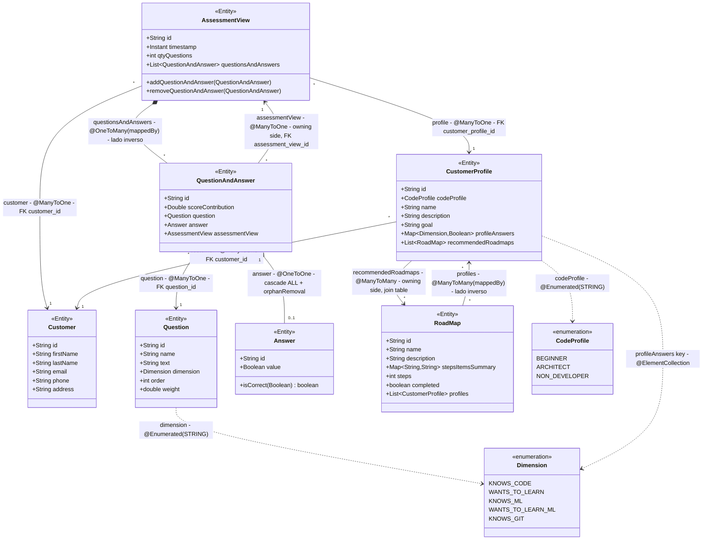
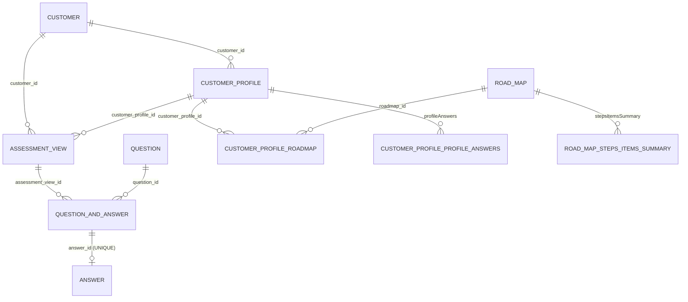

# Modelo JPA actual — guía didáctica

> Documento didáctico del modelo de datos **tal como está ahora** en la rama `task3-assessmentview-pending`.
>
> Objetivo: entender qué entidades hay, qué relaciones JPA existen, en qué fichero está cada una, por qué está ahí y si la relación es unidireccional o bidireccional.
>
> Todas las rutas de código son relativas a `compassMap/src/main/java/com/example/demo/`.

---

## 0. ¿Ya existía un diagrama?

Sí. En `docs/appends/dataModel-v2.md` hay un `classDiagram` de Mermaid con las entidades y sus relaciones.

Este documento **no lo sustituye ni lo modifica**. Lo amplía con lo que al diagrama del autor le falta para estudiarlo:

- Qué lado de cada relación es el **propietario** (`owning side`) y cuál es el **inverso** (`mappedBy`).
- En qué **fichero y línea** está cada anotación.
- Qué **tabla y columna** genera cada relación en H2.
- Por qué cada relación está en esa clase y no en la otra.
- Las **trampas** del modelo actual.

El diagrama de clases reutilizable está también en `docs/appends/jpa-model-current.mmd`.

---

## 1. Entidades actuales

| Entidad | Tabla principal | Para qué sirve |
|---|---|---|
| `Customer` | `CUSTOMER` | Cliente del sistema |
| `AssessmentView` | `ASSESSMENT_VIEW` | Una ejecución de un cuestionario |
| `QuestionAndAnswer` | `QUESTION_AND_ANSWER` | Una respuesta de esa ejecución a una pregunta |
| `Question` | `QUESTION` | Catálogo de preguntas |
| `Answer` | `ANSWER` | Valor booleano de una respuesta |
| `CustomerProfile` | `CUSTOMER_PROFILE` | Perfil resultante de un cliente |
| `RoadMap` | `ROAD_MAP` | Plantilla de hoja de ruta recomendada |

Enums:

| Enum | Dónde se usa |
|---|---|
| `CodeProfile` | `CustomerProfile.codeProfile` |
| `Dimension` | `Question.dimension` y las claves de `CustomerProfile.profileAnswers` |

---

## 2. Diagrama de clases



### Cómo leerlo

- La flecha `-->` va **desde la clase que tiene el campo** hacia la clase referenciada.
- `*--` indica **composición**: el hijo no tiene sentido sin el padre y su ciclo de vida está controlado por él.
- `..>` indica una **dependencia** o un uso, no una FK clásica (enums y `@ElementCollection`).
- `(owning side)` = lado que tiene la FK o la tabla intermedia.
- `(mappedBy)` = lado inverso, que Hibernate usa solo para navegar; **no decide el valor de la FK**.

---

## 3. Diagrama de tablas (vista de base de datos)



> En la base de datos local también existen `CUSTOMER_PROFILE_ANSWERS` y la columna `ROAD_MAP.STEPS_ITEMS_SUMMARY`. Son **restos antiguos** que `ddl-auto=update` no borra. El código actual **no las usa**; las tablas vigentes son `CUSTOMER_PROFILE_PROFILE_ANSWERS` y `ROAD_MAP_STEPS_ITEMS_SUMMARY`.

---

## 4. Inventario de relaciones

Leyenda de dirección:

- **Unidireccional**: solo una de las dos clases tiene un campo que apunta a la otra.
- **Bidireccional**: las dos clases tienen un campo; una de ellas usa `mappedBy`.

| # | Relación | Campo(s) Java | Anotación | Lado propietario | FK / tabla intermedia | Dirección | Fichero y línea |
|---|---|---|---|---|---|---|---|
| 1 | `Customer` 1 → N `AssessmentView` | `AssessmentView.customer` | `@ManyToOne` + `@JoinColumn(name = "customer_id")` | `AssessmentView` | `ASSESSMENT_VIEW.CUSTOMER_ID` | Unidireccional | `model/AssessmentView.java:33-35` |
| 2 | `Customer` 1 → N `CustomerProfile` | `CustomerProfile.customer` | `@ManyToOne` + `@JoinColumn(name = "customer_id")` | `CustomerProfile` | `CUSTOMER_PROFILE.CUSTOMER_ID` | Unidireccional | `model/CustomerProfile.java:36-38` |
| 3 | `CustomerProfile` 1 → N `AssessmentView` | `AssessmentView.profile` | `@ManyToOne` + `@JoinColumn(name = "customer_profile_id")` | `AssessmentView` | `ASSESSMENT_VIEW.CUSTOMER_PROFILE_ID` | Unidireccional | `model/AssessmentView.java:49-51` |
| 4 | `AssessmentView` 1 ↔ N `QuestionAndAnswer` | `AssessmentView.questionsAndAnswers` y `QuestionAndAnswer.assessmentView` | `@OneToMany(mappedBy = "assessmentView", cascade = ALL, orphanRemoval = true, fetch = LAZY)` + `@ManyToOne` + `@JoinColumn(name = "assessment_view_id")` | `QuestionAndAnswer` | `QUESTION_AND_ANSWER.ASSESSMENT_VIEW_ID` | **Bidireccional** | `model/AssessmentView.java:41-46`, `model/QuestionAndAnswer.java:38-43` |
| 5 | `QuestionAndAnswer` N → 1 `Question` | `QuestionAndAnswer.question` | `@ManyToOne` + `@JoinColumn(name = "question_id", nullable = false)` | `QuestionAndAnswer` | `QUESTION_AND_ANSWER.QUESTION_ID` | Unidireccional | `model/QuestionAndAnswer.java:27-29` |
| 6 | `QuestionAndAnswer` 1 → 0..1 `Answer` | `QuestionAndAnswer.answer` | `@OneToOne(cascade = ALL, orphanRemoval = true)` + `@JoinColumn(name = "answer_id")` | `QuestionAndAnswer` | `QUESTION_AND_ANSWER.ANSWER_ID` (**UNIQUE**) | Unidireccional | `model/QuestionAndAnswer.java:31-33` |
| 7 | `CustomerProfile` N ↔ N `RoadMap` | `CustomerProfile.recommendedRoadmaps` y `RoadMap.profiles` | `@ManyToMany(cascade = ALL, fetch = EAGER)` + `@JoinTable(name = "customer_profile_roadmap", ...)` + `@ManyToMany(mappedBy = "recommendedRoadmaps", fetch = EAGER)` | `CustomerProfile` | Tabla `CUSTOMER_PROFILE_ROADMAP` (`CUSTOMER_PROFILE_ID`, `ROADMAP_ID`) | **Bidireccional** | `model/CustomerProfile.java:40-45`, `model/RoadMap.java:44-48` |
| 8 | `CustomerProfile` → `profileAnswers` | `CustomerProfile.profileAnswers` | `@ElementCollection` | `CustomerProfile` | `CUSTOMER_PROFILE_PROFILE_ANSWERS` | Unidireccional (no es una entidad) | `model/CustomerProfile.java:33-34` |
| 9 | `RoadMap` → `stepsItemsSummary` | `RoadMap.stepsItemsSummary` | `@ElementCollection` | `RoadMap` | `ROAD_MAP_STEPS_ITEMS_SUMMARY` | Unidireccional (no es una entidad) | `model/RoadMap.java:34-35` |

---

## 5. Explicación relación por relación

### 5.1 `Customer` 1 → N `AssessmentView`

```java
// AssessmentView.java
@ManyToOne
@JoinColumn(name = "customer_id")
private Customer customer;
```

- **Dónde está la FK:** en `ASSESSMENT_VIEW.CUSTOMER_ID`.
- **Quién es el propietario:** `AssessmentView`.
- **Por qué aquí:** un assessment pertenece a un cliente. El cliente no tiene una lista de assessments; si la tuviera, cargar un cliente arrastraría todos sus assessments.
- **Cómo se navega al revés:** con una consulta derivada, `AssessmentViewRepository.findByCustomerId(...)` (`repository/AssessmentViewRepository.java:10`).
- **Dirección:** unidireccional.

### 5.2 `Customer` 1 → N `CustomerProfile`

```java
// CustomerProfile.java
@ManyToOne
@JoinColumn(name = "customer_id")
private Customer customer;
```

- **Dónde está la FK:** en `CUSTOMER_PROFILE.CUSTOMER_ID`.
- **Por qué `@ManyToOne` y no `@OneToOne`:** un cliente puede tener varios perfiles (uno por evaluación, el perfil evoluciona). La Task 2 lo pide así.
- **Cómo se navega al revés:** `CustomerProfileRepository.findByCustomerId(...)` (`repository/CustomerProfileRepository.java:10`).
- **Limitación conocida:** ese método devuelve `Optional<CustomerProfile>`. Si un cliente tiene más de un perfil, lanzaría `IncorrectResultSizeDataAccessException`. Hoy no está expuesto en ningún controller, por eso no se ha cambiado.
- **Dirección:** unidireccional.

### 5.3 `CustomerProfile` 1 → N `AssessmentView`

```java
// AssessmentView.java
@ManyToOne
@JoinColumn(name = "customer_profile_id")
private CustomerProfile profile;
```

- **Dónde está la FK:** en `ASSESSMENT_VIEW.CUSTOMER_PROFILE_ID`.
- **Por qué aquí:** cada assessment **resulta en** un perfil. El perfil es compartido: varios assessments pueden apuntar al mismo perfil.
- **Por qué `@ManyToOne` y no `@OneToOne`:** si fuera `@OneToOne`, la relación sería exclusiva y no se podrían reutilizar perfiles. Con `@ManyToOne` el perfil no se duplica.
- **Dirección:** unidireccional.

### 5.4 `AssessmentView` 1 ↔ N `QuestionAndAnswer` (la relación clave)

```java
// AssessmentView.java (lado inverso)
@OneToMany(mappedBy = "assessmentView", cascade = CascadeType.ALL,
           orphanRemoval = true, fetch = FetchType.LAZY)
private List<QuestionAndAnswer> questionsAndAnswers = new ArrayList<>();

// QuestionAndAnswer.java (lado propietario)
@ManyToOne
@JoinColumn(name = "assessment_view_id")
private AssessmentView assessmentView;
```

- **Dónde está la FK:** en `QUESTION_AND_ANSWER.ASSESSMENT_VIEW_ID`.
- **Quién es el propietario:** `QuestionAndAnswer`, porque es quien tiene la FK.
- **Qué significa `mappedBy = "assessmentView"`:** “esta colección es el lado inverso; el campo que manda es `QuestionAndAnswer.assessmentView`”.
- **Consecuencia práctica:** si solo añades el `QuestionAndAnswer` a la lista de `AssessmentView` sin asignar `questionAndAnswer.assessmentView`, Hibernate guarda la FK como `NULL`. Por eso existe el helper:

```java
public void addQuestionAndAnswer(QuestionAndAnswer questionAndAnswer) {
    questionsAndAnswers.add(questionAndAnswer);
    questionAndAnswer.setAssessmentView(this); // rellena la FK
}
```

- **`cascade = CascadeType.ALL`:** guardar o borrar el assessment propaga la operación a sus Q&A.
- **`orphanRemoval = true`:** si quitas una Q&A de la lista, se borra de la base de datos. Es la semántica de composición.
- **`fetch = FetchType.LAZY`:** la lista no se carga hasta que se usa. Por eso el servicio consulta por FK con `QuestionAndAnswerRepository.findByAssessmentViewId(...)` en lugar de navegar la colección fuera de una transacción.
- **Dirección:** bidireccional.

### 5.5 `QuestionAndAnswer` N → 1 `Question`

```java
// QuestionAndAnswer.java
@ManyToOne
@JoinColumn(name = "question_id", nullable = false)
private Question question;
```

- **Dónde está la FK:** en `QUESTION_AND_ANSWER.QUESTION_ID`, y es `NOT NULL`.
- **Por qué `@ManyToOne`:** la misma pregunta del catálogo se responde en muchos assessments.
- **Por qué no hay cascada:** `Question` es un catálogo compartido. No queremos que guardar una respuesta cree o borre preguntas.
- **Dirección:** unidireccional. `Question` no tiene lista de Q&A.

### 5.6 `QuestionAndAnswer` 1 → 0..1 `Answer`

```java
// QuestionAndAnswer.java
@OneToOne(cascade = CascadeType.ALL, orphanRemoval = true)
@JoinColumn(name = "answer_id")
private Answer answer;
```

- **Dónde está la FK:** en `QUESTION_AND_ANSWER.ANSWER_ID`.
- **Restricción extra en la BD:** esa columna tiene un `UNIQUE`, así que una `Answer` no puede pertenecer a dos Q&A.
- **Por qué `@OneToOne`:** cada Q&A tiene su propia respuesta.
- **Por qué cascada + `orphanRemoval`:** la `Answer` es parte de la composición; si se borra la Q&A, se borra su answer.
- **Dirección:** unidireccional. `Answer` no tiene referencia de vuelta.
- **Matiz:** `@OneToOne` es válido aquí porque la FK está en la tabla de la Q&A y la respuesta no se comparte. El documento `dataModel-v2.md` acepta este mapeo.

### 5.7 `CustomerProfile` N ↔ N `RoadMap`

```java
// CustomerProfile.java (lado propietario)
@ManyToMany(cascade = CascadeType.ALL, fetch = FetchType.EAGER)
@JoinTable(name = "customer_profile_roadmap",
        joinColumns = @JoinColumn(name = "customer_profile_id"),
        inverseJoinColumns = @JoinColumn(name = "roadmap_id"))
private List<RoadMap> recommendedRoadmaps;

// RoadMap.java (lado inverso)
@ManyToMany(fetch = FetchType.EAGER, mappedBy = "recommendedRoadmaps")
@JsonIgnore
@EqualsAndHashCode.Exclude
private List<CustomerProfile> profiles;
```

- **Dónde está la relación:** en la tabla intermedia `CUSTOMER_PROFILE_ROADMAP`.
- **Quién es el propietario:** `CustomerProfile`, porque es quien declara el `@JoinTable`.
- **Qué significa `mappedBy = "recommendedRoadmaps"`:** `RoadMap.profiles` es el lado inverso; añadir un perfil a `roadMap.getProfiles()` **no** guarda nada. Hay que modificar `customerProfile.getRecommendedRoadmaps()`.
- **`@JsonIgnore` en `RoadMap.profiles`:** evita el bucle infinito al serializar `profile → roadmaps → profiles → ...`.
- **`@EqualsAndHashCode.Exclude` en `RoadMap.profiles`:** evita la recursión de Lombok en `equals()`/`hashCode()`.
- **`cascade = CascadeType.ALL`:** viene pedido literalmente por la Task 2. **Cuidado:** `REMOVE` en una relación muchos-a-muchos puede borrar roadmaps compartidos por otros perfiles. El documento `dataModel-v2.md` recomienda limitarlo a `PERSIST`/`MERGE`, pero no se ha cambiado porque la tarea pide `ALL`.
- **`fetch = EAGER`:** también viene pedido por la tarea. Carga los roadmaps junto con el perfil; en consultas grandes genera joins pesados.
- **Cómo se actualiza de forma segura:** `CustomerProfileService.updateCustomerProfile` resuelve cada roadmap por `id` contra `RoadMapRepository` antes de asignarlo (`service/CustomerProfileService.java:99-110`). Así no se crean roadmaps nuevos por accidente.
- **Dirección:** bidireccional.

### 5.8 `CustomerProfile.profileAnswers` (`@ElementCollection`)

```java
@ElementCollection
private Map<Dimension, Boolean> profileAnswers;
```

- **No es una relación entre entidades.** Es una colección de valores básicos (`Dimension` → `Boolean`).
- **Tabla:** `CUSTOMER_PROFILE_PROFILE_ANSWERS` con columnas `CUSTOMER_PROFILE_ID`, `PROFILE_ANSWERS_KEY` y `PROFILE_ANSWERS`.
- **Clave del mapa:** `Dimension` se guarda como `TINYINT` (ordinal), **no** como texto. Si se reordena el enum `Dimension`, los datos antiguos se interpretarían mal. `Question.dimension` y `CustomerProfile.codeProfile`, en cambio, usan `@Enumerated(EnumType.STRING)` y se guardan como texto.
- **Tabla antigua:** `CUSTOMER_PROFILE_ANSWERS` es un resto de una versión anterior. No la usa el código actual.

### 5.9 `RoadMap.stepsItemsSummary` (`@ElementCollection`)

```java
@ElementCollection
private Map<String, String> stepsItemsSummary;
```

- **No es una relación entre entidades.** Es un mapa de pasos/resumen.
- **Tabla:** `ROAD_MAP_STEPS_ITEMS_SUMMARY` con `ROAD_MAP_ID`, `STEPS_ITEMS_SUMMARY_KEY` y `STEPS_ITEMS_SUMMARY`.
- **Resto antiguo:** la columna `ROAD_MAP.STEPS_ITEMS_SUMMARY` (tipo binario) quedó de una versión anterior y ya no se usa.

---

## 6. Fichero por fichero: dónde está cada relación y por qué

### `model/Customer.java`

- **No tiene relaciones.** Solo atributos y `@Id`.
- **Por qué:** es la raíz del modelo. Las demás entidades apuntan a él. Mantenerlo sin colecciones evita cargar grafos enormes al leer un cliente.
- **Cómo se navega:** con consultas de repositorio (`findByCustomerId`).

### `model/AssessmentView.java`

- **`customer`** (`@ManyToOne`, líneas 33-35): el assessment pertenece a un cliente.
- **`questionsAndAnswers`** (`@OneToMany(mappedBy = "assessmentView")`, líneas 41-46): lado inverso de la composición con Q&A.
- **`profile`** (`@ManyToOne`, líneas 49-51): el assessment apunta al perfil resultante.
- **Por qué aquí:** `AssessmentView` es la raíz del agregado del cuestionario; por eso referencia al cliente y al perfil, y declara la colección de Q&A.

### `model/QuestionAndAnswer.java`

- **`question`** (`@ManyToOne`, líneas 27-29): catálogo compartido.
- **`answer`** (`@OneToOne`, líneas 31-33): respuesta propia, en composición.
- **`assessmentView`** (`@ManyToOne`, líneas 38-43): **lado propietario** de la relación con el assessment; aquí vive la FK `ASSESSMENT_VIEW_ID`.
- **Por qué aquí:** es la entidad que une “una evaluación” con “una pregunta” y su respuesta. Por eso concentra tres relaciones.

### `model/Question.java`

- **No tiene relaciones.** Solo `dimension` (`@Enumerated(STRING)`, líneas 24-25) y el campo `order`, mapeado a `question_order` porque `order` es palabra reservada en H2 (líneas 26-30).
- **Por qué:** es un catálogo de preguntas reutilizable.

### `model/Answer.java`

- **No tiene relaciones.** Solo `id` y `value`, mapeado a `answer_value` (líneas 18-21).
- **Por qué:** su ciclo de vida pertenece a `QuestionAndAnswer` mediante `cascade = ALL` y `orphanRemoval = true`.

### `model/CustomerProfile.java`

- **`profileAnswers`** (`@ElementCollection`, líneas 33-34): respuestas por dimensión.
- **`customer`** (`@ManyToOne`, líneas 36-38): el perfil pertenece a un cliente.
- **`recommendedRoadmaps`** (`@ManyToMany`, líneas 40-45): lado propietario de la relación con `RoadMap`.
- **Por qué aquí:** el perfil es el resultado del assessment y el objeto que recomienda roadmaps.

### `model/RoadMap.java`

- **`stepsItemsSummary`** (`@ElementCollection`, líneas 34-35): pasos de la hoja de ruta.
- **`profiles`** (`@ManyToMany(mappedBy = "recommendedRoadmaps")`, líneas 44-48): lado inverso de la relación con `CustomerProfile`.
- **Por qué aquí:** el roadmap es una plantilla compartida; el perfil es quien decide qué roadmaps recomienda.

### Repositorios que sustituyen a la navegación inversa

| Consulta | Fichero y línea | Para qué |
|---|---|---|
| `AssessmentViewRepository.findByCustomerId(...)` | `repository/AssessmentViewRepository.java:10` | Assessments de un cliente |
| `CustomerProfileRepository.findByCustomerId(...)` | `repository/CustomerProfileRepository.java:10` | Perfil de un cliente (hoy `Optional`) |
| `QuestionAndAnswerRepository.findByAssessmentViewId(...)` | `repository/QuestionAndAnswerRepository.java:10` | Q&A de un assessment sin navegar la colección `LAZY` |

---

## 7. Conceptos JPA usados en este proyecto

### Entidad e identidad

- `@Entity` marca una clase como tabla.
- `@Id` marca la clave primaria. En este proyecto todas son `String` (UUID o ids legibles como `P01`).

### `@ManyToOne`

- Muchas filas de esta entidad apuntan a una fila de la otra.
- **La FK vive en la tabla de la entidad que tiene el campo.**
- Ejemplo: `AssessmentView.customer` → `ASSESSMENT_VIEW.CUSTOMER_ID`.

### `@OneToMany`

- Una fila de esta entidad tiene muchas filas de la otra.
- Si la relación es bidireccional, **siempre** lleva `mappedBy` y es el lado inverso.
- Ejemplo: `AssessmentView.questionsAndAnswers`.

### `@OneToOne`

- Una fila se corresponde con una sola fila de la otra.
- La FK puede estar en cualquiera de las dos tablas; aquí está en `QUESTION_AND_ANSWER.ANSWER_ID`, con `UNIQUE`.
- Ejemplo: `QuestionAndAnswer.answer`.

### `@ManyToMany`

- Muchas filas se relacionan con muchas filas.
- Necesita una **tabla intermedia**.
- El lado que declara `@JoinTable` es el propietario; el otro usa `mappedBy`.
- Ejemplo: `CustomerProfile.recommendedRoadmaps` ↔ `RoadMap.profiles`.

### Lado propietario (`owning side`) y lado inverso (`mappedBy`)

Regla mental:

> **La FK manda.** El lado que tiene la FK (o la tabla intermedia) es el propietario. El lado `mappedBy` es solo una vista de navegación.

Consecuencias:

- Cambiar solo el lado `mappedBy` **no** actualiza la base de datos.
- Hay que modificar el lado propietario o usar helpers que sincronicen ambos lados (`addQuestionAndAnswer`, `removeQuestionAndAnswer`).

### `@JoinColumn`

- Personaliza el nombre de la columna FK.
- Ejemplo: `@JoinColumn(name = "customer_id")`.

### `@JoinTable`

- Define la tabla intermedia de un `@ManyToMany`.
- `joinColumns` = FK hacia esta entidad.
- `inverseJoinColumns` = FK hacia la otra entidad.
- Ejemplo: `customer_profile_roadmap`.

### `cascade`

- Propaga operaciones del padre al hijo.
- `CascadeType.ALL` incluye `PERSIST`, `MERGE`, `REMOVE`, `REFRESH`, `DETACH`.
- En este proyecto:
  - `AssessmentView.questionsAndAnswers`: `ALL` (composición).
  - `QuestionAndAnswer.answer`: `ALL` (composición).
  - `CustomerProfile.recommendedRoadmaps`: `ALL` (pedido por la Task 2, aunque es una asociación compartida).

### `fetch`

- `LAZY`: carga la relación cuando se usa.
- `EAGER`: la carga siempre.
- En este proyecto:
  - `questionsAndAnswers`: `LAZY`.
  - `recommendedRoadmaps` y `RoadMap.profiles`: `EAGER`.

### `orphanRemoval`

- Si un hijo se queda sin padre (se quita de la colección), se borra.
- En este proyecto:
  - `AssessmentView.questionsAndAnswers`: `true`.
  - `QuestionAndAnswer.answer`: `true`.

### `@ElementCollection`

- Colección de valores básicos o embebidos, no de entidades.
- No tiene repositorio propio; se guarda con el padre.
- En este proyecto: `profileAnswers` y `stepsItemsSummary`.

### `@Enumerated`

- `EnumType.STRING`: guarda el nombre del enum como texto (más legible y estable).
- `EnumType.ORDINAL`: guarda el índice (frágil si cambia el orden).
- En este proyecto: `Question.dimension` y `CustomerProfile.codeProfile` usan `STRING`. La **clave** del mapa `profileAnswers` no lleva `@MapKeyEnumerated`, así que se guarda como ordinal.

### Anotaciones de serialización y Lombok

- `@JsonIgnore`: no serializa ese campo (evita bucles).
- `@JsonProperty(access = WRITE_ONLY)`: acepta el campo en el JSON de entrada, pero no lo devuelve en la respuesta.
- `@ToString.Exclude` y `@EqualsAndHashCode.Exclude`: evitan recursión infinita en `toString()`, `equals()` y `hashCode()`.

---

## 8. Cómo se guarda el agregado

### Crear un assessment

`AssessmentViewService.createAssessmentView(...)`:

1. Genera el `id` y el `timestamp` (líneas 45-49).
2. Resuelve `customer` y `profile` por id contra sus repositorios (líneas 51-59).
3. Copia la lista de Q&A entrante (líneas 76-78).
4. Vacía la colección del assessment (línea 81).
5. Recorre cada Q&A:
   - genera su `id` (línea 86);
   - resuelve la `Question` por id (líneas 94-99);
   - genera el `id` de la `Answer` si falta (líneas 103-105);
   - llama a `addQuestionAndAnswer(...)` para sincronizar ambos lados (línea 109).
6. Calcula `qtyQuestions` (línea 113).
7. Guarda una sola vez y deja que la cascada guarde Q&A y answers (línea 116).

**Por qué se reconstruye la lista:** el lado `mappedBy` no decide la FK. Sin `questionAndAnswer.setAssessmentView(...)`, la columna `assessment_view_id` se guardaría a `NULL`.

### Actualizar un perfil

`CustomerProfileService.updateCustomerProfile(...)`:

1. Comprueba que el perfil existe.
2. Copia solo los campos no nulos (semántica de actualización parcial).
3. Si llega `recommendedRoadmaps`, resuelve cada roadmap por id contra `RoadMapRepository` (líneas 99-110).
4. Guarda el perfil.

**Por qué se resuelve por id:** `RoadMap` es una entidad compartida. Si se confiara en los objetos del JSON, `cascade = ALL` podría intentar crear roadmaps nuevos o tratar entidades detached como si fueran nuevas.

---

## 9. Trampas y detalles del proyecto

| Tema | Qué pasa | Qué hacer |
|---|---|---|
| `LAZY` fuera de transacción | Acceder a `assessmentView.getQuestionsAndAnswers()` fuera de una sesión puede lanzar `LazyInitializationException`. | Usar `QuestionAndAnswerRepository.findByAssessmentViewId(...)`. |
| `EAGER` en ambos lados del M:N | Cada consulta de perfil o roadmap puede arrastrar joins grandes. | Asumido por la Task 2; no cambiar sin decisión. |
| `CascadeType.ALL` en `recommendedRoadmaps` | `REMOVE` podría borrar roadmaps compartidos. | La Task 2 lo pide; documentado como riesgo. |
| Crear perfiles con roadmaps | `createCustomerProfile` no resuelve roadmaps por id; con `cascade = ALL`, un roadmap detached puede dar problemas. | En el alta, enviar roadmaps ya existentes y gestionados, o ampliar el servicio si se necesita. |
| `profileAnswers` con enum ordinal | La clave `Dimension` se guarda como `TINYINT`; reordenar el enum cambia el significado. | No reordenar `Dimension`; si se necesita, añadir `@MapKeyEnumerated(STRING)`. |
| `ddl-auto=update` | Deja tablas y columnas antiguas (`CUSTOMER_PROFILE_ANSWERS`, `ROAD_MAP.STEPS_ITEMS_SUMMARY`). | No usarlas; para limpiar, recrear la BD. |
| `findByCustomerId` devuelve `Optional` | Con más de un perfil por cliente, lanza excepción. | Limitación conocida; no está expuesta en controller. |
| Bucles JSON | `profile → roadmaps → profiles` y `assessment → Q&A → assessment`. | `@JsonIgnore` y `@JsonProperty(WRITE_ONLY)`. |
| Bucles Lombok | `@Data` genera `equals`/`hashCode`/`toString` recursivos. | `@ToString.Exclude` y `@EqualsAndHashCode.Exclude`. |

---

## 10. Cómo comprobarlo en H2

Abre `http://localhost:8080/h2-console` con:

- JDBC URL: `jdbc:h2:file:C:/Users/jrobl/AppData/Local/compassMap/db/compassmapdb`
- Usuario: `albert`
- Contraseña: `1234`

Consultas útiles:

```sql
-- Tablas actuales
SELECT TABLE_NAME
FROM INFORMATION_SCHEMA.TABLES
WHERE TABLE_SCHEMA = 'PUBLIC' AND TABLE_TYPE = 'BASE TABLE'
ORDER BY TABLE_NAME;

-- Un assessment con su cliente y su perfil
SELECT av.id, c.first_name, cp.name AS profile
FROM ASSESSMENT_VIEW av
LEFT JOIN CUSTOMER c ON c.id = av.customer_id
LEFT JOIN CUSTOMER_PROFILE cp ON cp.id = av.customer_profile_id;

-- Q&A de un assessment
SELECT qaa.id, q.text, a.answer_value, qaa.score_contribution
FROM QUESTION_AND_ANSWER qaa
JOIN QUESTION q ON q.id = qaa.question_id
LEFT JOIN ANSWER a ON a.id = qaa.answer_id
WHERE qaa.assessment_view_id = '<id>';

-- Roadmaps recomendados por perfil
SELECT cp.name AS profile, rm.name AS roadmap
FROM CUSTOMER_PROFILE cp
JOIN CUSTOMER_PROFILE_ROADMAP cpr ON cpr.customer_profile_id = cp.id
JOIN ROAD_MAP rm ON rm.id = cpr.roadmap_id;

-- Respuestas por dimensión (clave ordinal)
SELECT cp.name, pa.profile_answers_key, pa.profile_answers
FROM CUSTOMER_PROFILE cp
JOIN CUSTOMER_PROFILE_PROFILE_ANSWERS pa ON pa.customer_profile_id = cp.id;
```

---

## 11. Chuleta final

| Pregunta | Respuesta |
|---|---|
| ¿Dónde está la FK de un assessment a su cliente? | `ASSESSMENT_VIEW.CUSTOMER_ID` |
| ¿Dónde está la FK de un assessment a su perfil? | `ASSESSMENT_VIEW.CUSTOMER_PROFILE_ID` |
| ¿Dónde está la FK de una Q&A a su assessment? | `QUESTION_AND_ANSWER.ASSESSMENT_VIEW_ID` |
| ¿Quién es el propietario de `AssessmentView` ↔ `QuestionAndAnswer`? | `QuestionAndAnswer` |
| ¿Quién es el propietario de `CustomerProfile` ↔ `RoadMap`? | `CustomerProfile` |
| ¿Qué relación es unidireccional? | Cliente→Assessment, Cliente→Perfil, Perfil→Assessment, Q&A→Question, Q&A→Answer, colecciones de básicos |
| ¿Qué relación es bidireccional? | `AssessmentView` ↔ `QuestionAndAnswer` y `CustomerProfile` ↔ `RoadMap` |
| ¿Cómo navego de un cliente a sus assessments? | `AssessmentViewRepository.findByCustomerId(...)` |
| ¿Cómo navego de un cliente a sus perfiles? | `CustomerProfileRepository.findByCustomerId(...)` (hoy `Optional`) |
| ¿Dónde se sincronizan ambos lados de la composición? | `AssessmentView.addQuestionAndAnswer(...)` y `removeQuestionAndAnswer(...)` |
| ¿Dónde se resuelven los roadmaps por id? | `CustomerProfileService.updateCustomerProfile(...)`, líneas 99-110 |
