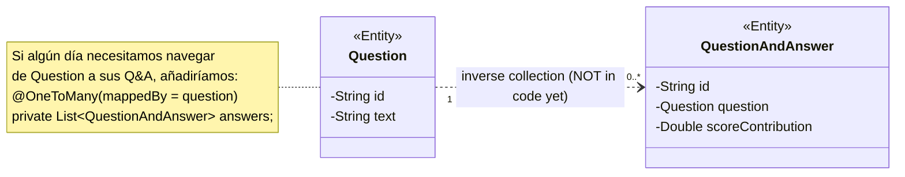
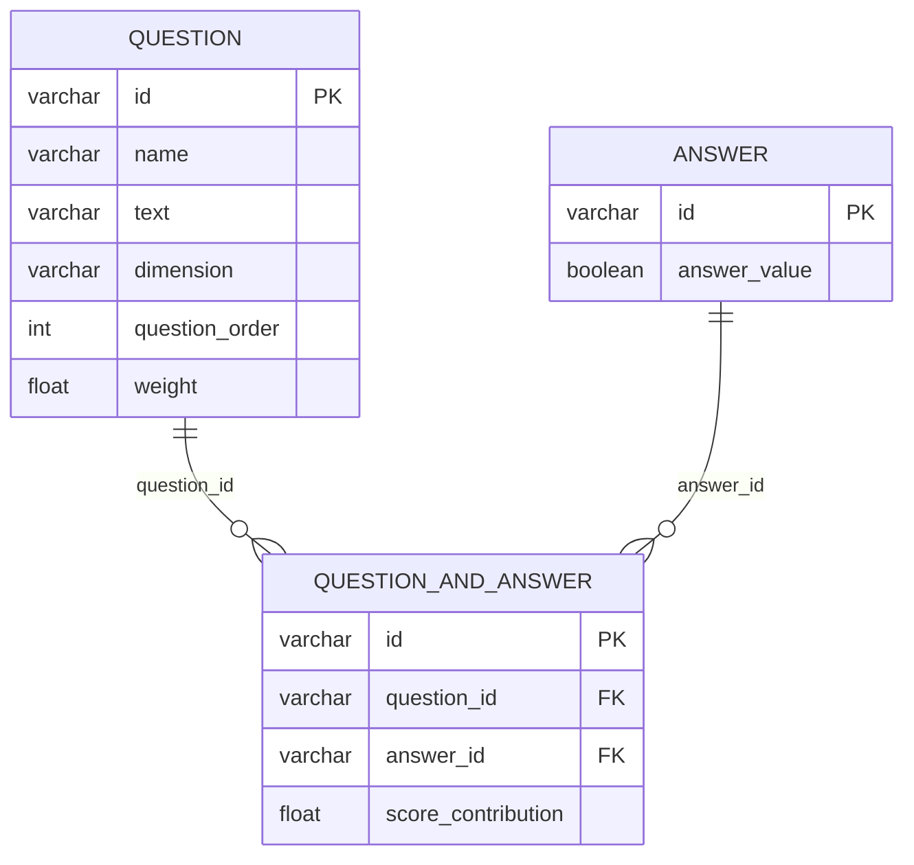

# Task 1 — `QuestionAndAnswer` como `@Entity` (`@ManyToOne`)

> Rama: `task1-qanda` · Alcance: **solo Task 1**. Tasks 2 (`CustomerProfile`) y 3
> (`AssessmentView`) **no** se implementan en esta rama.
>
> Documento de apoyo: [compassMap masterDoc v2](../compassMap_v2.md) ·
> [Data Model v1](./dataModel-v1.md) ·
> [JPA Relationships Guide](https://github.com/AlbertProfe/ApartmentPredictor/blob/master/docs/appends/JPA_Relationships_Guide.md)
>
> Registro completo de fallos y correcciones: [task1-troubleshooting.md](./task1-troubleshooting.md)

---

## 1. Resumen

En `v1`, `QuestionAndAnswer` era un POJO: guardaba referencias Java a `Question` y
`Answer`, pero **no era una tabla** y no existía ninguna `foreign key`.

En `v2` / Task 1 pasa a ser una entidad persistente que **materializa la relación
muchos-a-uno** con el catálogo de preguntas y con el catálogo de respuestas:

| Antes (`v1`) | Después (Task 1) |
|---|---|
| POJO sin `@Entity` | `@Entity` → tabla `question_and_answer` |
| `Question question` como campo Java | `@ManyToOne` + FK `question_id` |
| `Answer answer` como campo Java | `@ManyToOne` + FK `answer_id` |
| Sin repositorio funcional | `QuestionAndAnswerRepository` con queries derivadas |
| Servicio con `TODO` | Servicio que resuelve las FK y persiste |
| Sin endpoints de `Answer` | `AnswerRepository` + `AnswerService` + `AnswerRestController` |

**Resultado:** una fila de `question_and_answer` representa *“a esta pregunta se le
dio esta respuesta, y aportó estos puntos”*. La pregunta y la respuesta **no se
duplican**: se referencian por id.

---

## 2. Diagrama UML de Task 1 (Mermaid)

```mermaid
classDiagram
    direction LR

    class Question {
        <<Entity>>
        -String id
        -String name
        -String text
        -Dimension dimension
        -int order
        -double weight
    }

    class Answer {
        <<Entity>>
        -String id
        -Boolean value
    }

    class QuestionAndAnswer {
        <<Entity>>
        -String id
        -Question question
        -Answer answer
        -Double scoreContribution
    }

    class Dimension {
        <<enumeration>>
        KNOWS_CODE
        WANTS_TO_LEARN
        KNOWS_ML
        WANTS_TO_LEARN_ML
        KNOWS_GIT
    }

    QuestionAndAnswer "0..*" --> "1" Question : question  (FK question_id)
    QuestionAndAnswer "0..*" --> "1" Answer : answer  (FK answer_id)

    Question --> Dimension : dimension

    note for QuestionAndAnswer "OWNING SIDE<br/>La tabla question_and_answer guarda<br/>question_id y answer_id"
    note for Question "NO tiene List&lt;QuestionAndAnswer&gt;:<br/>la relación es unidireccional"
    note for Answer "NO tiene List&lt;QuestionAndAnswer&gt;:<br/>la relación es unidireccional"

    classDef implemented fill:#d4edda,stroke:#28a745,stroke-width:2px
    classDef enum fill:#fff3cd,stroke:#ffc107
    class Question,Answer,QuestionAndAnswer implemented
    class Dimension enum
```

### Cómo leer las flechas

- La flecha va **desde el lado que “conoce” al otro**: `QuestionAndAnswer` conoce a
  `Question` y a `Answer`, porque tiene los campos `question` y `answer`.
- `"0..*"` en el origen y `"1"` en el destino se lee: **muchas** filas de
  `QuestionAndAnswer` apuntan a **una** `Question` (y lo mismo con `Answer`).
- En la base de datos eso se traduce en **dos columnas FK dentro de
  `question_and_answer`**, no en una tabla intermedia.

### La relación inversa (lógica, pero NO implementada)



La línea **punteada** significa “relación inversa opcional que todavía no está en el
código”. Si se añade, el lado `Question` sería el **inverse side** y usaría
`mappedBy = "question"`, porque la FK sigue viviendo en `question_and_answer`.

---

## 3. Contexto: dónde encaja Task 1 en el modelo v2

El modelo completo de v2 tiene 7 entidades. En esta rama **solo se implementan las
tres del bloque Q&A** (en verde). El resto se queda para sus tasks.

```mermaid
classDiagram
    direction TB

    class Customer
    class AssessmentView
    class CustomerProfile
    class RoadMap
    class Question
    class Answer
    class QuestionAndAnswer

    Customer "1" --> "0..*" AssessmentView : assessments
    AssessmentView "0..*" --> "1" Customer : customer
    AssessmentView "1" --> "0..*" QuestionAndAnswer : questionsAndAnswers
    QuestionAndAnswer "0..*" --> "1" Question : question
    QuestionAndAnswer "0..*" --> "1" Answer : answer
    AssessmentView "0..*" --> "1" CustomerProfile : profile
    Customer "1" --> "0..1" CustomerProfile : profile
    CustomerProfile "0..*" --> "1" RoadMap : recommendedRoadmap

    note for AssessmentView "Task 3<br/>(todavía NO es @Entity)"
    note for CustomerProfile "Task 2<br/>(sin relaciones todavía)"

    classDef task1 fill:#d4edda,stroke:#28a745,stroke-width:2px
    classDef pending fill:#f8f9fa,stroke:#adb5bd,stroke-dasharray:5 5
    class Question,Answer,QuestionAndAnswer task1
    class Customer,AssessmentView,CustomerProfile,RoadMap pending
```

> **Ojo con el snippet del masterDoc:** el código de Task 1 del masterDoc incluye
> `@ManyToOne private AssessmentView assessmentView`. Ese campo pertenece en
> realidad a la relación que crea **Task 3**: `AssessmentView` todavía no es
> `@Entity`, así que la FK `assessment_view_id` **no se puede mapear en esta rama**.
> En el código queda como `// TODO (Task 3)`.

---

## 4. Diagrama entidad-relación (lo que se crea en H2)



El DDL que genera Hibernate (resumido) es:

```sql
create table question_and_answer (
    id                 varchar(255) not null,
    score_contribution float(53),
    answer_id          varchar(255) not null,
    question_id        varchar(255) not null,
    primary key (id)
);

alter table question_and_answer
    add constraint FK_... foreign key (answer_id) references answer;
alter table question_and_answer
    add constraint FK_... foreign key (question_id) references question;
```

Fíjate en un detalle clave: **no hay tabla `question_and_answer_answers` ni
`..._questions`**. Una relación `@ManyToOne` **no necesita tabla intermedia**; la FK
va en la tabla del lado “muchos”. Las tablas intermedias (`join tables`) aparecen con
`@ManyToMany`, y las tablas hijas con `@ElementCollection`.

---

## 5. Las relaciones JPA explicadas despacio

### 5.1 `@Entity` = tabla, campo = columna

| Concepto Java | Concepto SQL |
|---|---|
| `@Entity class QuestionAndAnswer` | tabla `question_and_answer` |
| `@Id String id` | `id` PRIMARY KEY |
| `String scoreContribution` | columna `score_contribution` |
| `Question question` + `@ManyToOne` | columna `question_id` + FOREIGN KEY |

`QuestionAndAnswer` **no guarda** el texto de la pregunta ni el valor booleano de la
respuesta: guarda **ids**. El objeto Java completo se reconstruye al leer, haciendo
un `JOIN` entre `question_and_answer` y `question` / `answer`.

### 5.2 Cardinalidad: `@ManyToOne` en el lado “muchos”

La pregunta que hay que hacerse siempre es: **¿dónde vive la FK?**

- Una `Question` puede aparecer en muchas filas de `QuestionAndAnswer`.
- Cada fila de `QuestionAndAnswer` apunta a **una sola** `Question`.
- Por tanto: **`Question 1 ──── * QuestionAndAnswer`**.
- La FK se guarda en el lado `*`, es decir, en `question_and_answer.question_id`.

En JPA, el lado que guarda la FK se anota con `@ManyToOne` y se llama **owning
side** (lado propietario):

```java
@ManyToOne(optional = false, fetch = FetchType.EAGER)
@JoinColumn(name = "question_id", nullable = false)
private Question question;
```

- `@ManyToOne` describe la cardinalidad **desde el punto de vista de esta clase**:
  “muchos Q&A → una Question”.
- `@JoinColumn(name = "question_id")` decide **el nombre exacto** de la columna FK.
  Sin él, Hibernate usaría `question_id` por convención, pero ponerlo explícito hace
  el modelo legible y estable.
- `nullable = false` / `optional = false` → la relación es obligatoria.

Lo mismo ocurre con `Answer`:

```java
@ManyToOne(optional = false, fetch = FetchType.EAGER)
@JoinColumn(name = "answer_id", nullable = false)
private Answer answer;
```

### 5.3 ¿Bidireccional o unidireccional?

**Task 1 es unidireccional**: solo `QuestionAndAnswer` conoce a `Question` y a
`Answer`. `Question` y `Answer` **no tienen** una `List<QuestionAndAnswer>`.

```java
// ASÍ ESTÁ (unidireccional)
class QuestionAndAnswer { Question question; Answer answer; }

// ASÍ SERÍA BIDIRECCIONAL (no lo hacemos en Task 1)
class Question {
    @OneToMany(mappedBy = "question")
    List<QuestionAndAnswer> answers;
}
```

¿Por qué unidireccional?

1. **No lo necesitamos**: para pintar una Q&A ya tenemos la pregunta y la respuesta.
2. **Evita ciclos**: `QuestionAndAnswer → Question → List<QuestionAndAnswer> → ...`
   complica `toString()`, `equals()` y la serialización JSON (bucles infinitos).
3. **Evita cascadas accidentales**: una lista en el catálogo invita a borrar
   preguntas “en cascada” y arrastrar respuestas históricas.
4. **Se puede añadir después sin migrar datos**: la FK ya existe; solo sería un
   campo nuevo con `mappedBy`.

Regla mental:

| Anotación | ¿Dónde va? | ¿Lleva `mappedBy`? |
|---|---|---|
| `@ManyToOne` | owning side (tabla con FK) | **No** |
| `@OneToMany` | inverse side (no tiene FK) | **Sí**, obligatorio |
| `@OneToOne` owning | tabla con FK | No |
| `@OneToOne` inverse | tabla sin FK | Sí |
| `@ManyToMany` | owning side (tabla intermedia) | No (en el owning) |

Como en Task 1 **no hay ningún `@OneToMany`**, en todo el código de Task 1 **no
aparece `mappedBy`**. Eso es correcto, no es un olvido.

### 5.4 Por qué `@ManyToOne` y no `@OneToOne` para `Answer`

La rama empezó con esta versión:

```java
// ❌ INCORRECTO para este modelo
@OneToOne(cascade = CascadeType.ALL, orphanRemoval = true)
@JoinColumn(name = "answer_id")
private Answer answer;
```

`@OneToOne` dice: “**una** fila de `question_and_answer` se corresponde con **una**
`Answer`, y esa `Answer` no puede estar referenciada por ninguna otra fila”. Eso es
falso en el dominio: las respuestas son un **catálogo** (`true` / `false`) que se
reutiliza en todas las preguntas y en todas las evaluaciones.

Ejemplo real con dos Q&A que responden `true`:

| `question_and_answer.id` | `question_id` | `answer_id` |
|---|---|---|
| `qa-1` | `q-1` | `answer-true` |
| `qa-2` | `q-2` | `answer-true` |

Con `@ManyToOne` esto es perfectamente válido. Con `@OneToOne` Hibernate añadiría una
restricción de unicidad sobre `answer_id` y la segunda fila fallaría.

Y el `cascade = CascadeType.ALL` + `orphanRemoval = true` era peor todavía:

- `CascadeType.ALL` incluye `REMOVE`: borrar `qa-1` intentaría borrar
  `answer-true`, que `qa-2` sigue usando → error de FK o pérdida de datos
  compartidos.
- `orphanRemoval` está pensado para hijos **propiedad** de un padre (composición),
  no para valores de un catálogo compartido.
- `CascadeType.PERSIST` haría que guardar una Q&A intente insertar otra vez la
  `Answer` con el mismo id → `primary key violation`.

**Conclusión:** la `Answer` tiene ciclo de vida propio; se crea antes y se comparte.
Por eso `@ManyToOne` **sin cascade** y con la FK obligatoria.

### 5.5 ¿Y las cascadas? ¿Dónde sí?

En Task 1 **ninguna**. `Question` y `Answer` son catálogo: si guardas una Q&A no
quieres crear preguntas nuevas, y si borras una Q&A no quieres borrar la pregunta ni
la respuesta.

La cascada sí aparecerá en **Task 3**:

```java
// AssessmentView (Task 3) — composición: las Q&A pertenecen a la evaluación
@OneToMany(mappedBy = "assessmentView",
           cascade = CascadeType.ALL,
           orphanRemoval = true,
           fetch = FetchType.LAZY)
private List<QuestionAndAnswer> questionsAndAnswers;
```

Ahí sí tiene sentido: las filas de `QuestionAndAnswer` **no existen sin** su
`AssessmentView`; son parte de la evaluación.

### 5.6 `FetchType`: EAGER vs LAZY

- `@ManyToOne` en JPA **por defecto es EAGER**: al cargar la Q&A, Hibernate trae
  también la `Question` y la `Answer` (con `JOIN` o selects adicionales).
- `@OneToMany` por defecto es **LAZY**: la lista se carga solo si la tocas.

En Task 1 se ha dejado `EAGER` **explícito** por dos motivos:

1. El JSON de una Q&A siempre incluye `question` y `answer`; se necesitan sí o sí.
2. Al devolver la entidad directamente desde el controlador, `LAZY` puede provocar
   `LazyInitializationException` al serializar con Jackson fuera de la transacción.

Trade-off: con muchos registros, `EAGER` puede generar **N+1** (una query por cada
Q&A). La solución profesional es `LAZY` + DTO/`JOIN FETCH`/`@EntityGraph`:

```java
@Query("select qa from QuestionAndAnswer qa " +
       "join fetch qa.question join fetch qa.answer " +
       "where qa.id = :id")
Optional<QuestionAndAnswer> findByIdWithRelations(@Param("id") String id);
```

Para el tamaño de este proyecto, `EAGER` es una decisión consciente y documentada.

### 5.7 `optional = false` + `nullable = false`: dos niveles de obligatoriedad

- `optional = false` es **JPA**: el objeto Java no puede ser `null` al persistir.
- `nullable = false` es **DDL**: Hibernate genera `question_id varchar(255) not null`.

Además, el servicio **valida antes** de guardar y devuelve `400 Bad Request` con un
mensaje claro si el id no existe. Sin esa validación, el cliente recibiría un
`500 Internal Server Error` con una violación de FK de H2, mucho menos útil.

### 5.8 Por qué `assessmentView` se queda para Task 3

`@ManyToOne` necesita una entidad destino gestionada por JPA. `AssessmentView`
todavía tiene `@Entity` comentado, así que mapear la relación ahora rompería el
arranque de Hibernate. En el código queda:

```java
// TODO (Task 3): @ManyToOne assessmentView
// @ManyToOne(fetch = FetchType.LAZY)
// @JoinColumn(name = "assessment_view_id")
// private AssessmentView assessmentView;
```

Cuando se haga Task 3, la tabla `question_and_answer` ganará la columna
`assessment_view_id` y el `@OneToMany` de `AssessmentView` usará
`mappedBy = "assessmentView"`. **La FK no cambia de sitio**: sigue en
`question_and_answer`, el lado “muchos”.

---

## 6. Código de Task 1

### 6.1 Entidad

`compassMap/src/main/java/com/example/demo/model/QuestionAndAnswer.java`

```java
@Entity
@Data
@Builder
@NoArgsConstructor
@AllArgsConstructor
public class QuestionAndAnswer {

    @Id
    private String id;

    @ManyToOne(optional = false, fetch = FetchType.EAGER)
    @JoinColumn(name = "question_id", nullable = false)
    private Question question;

    @ManyToOne(optional = false, fetch = FetchType.EAGER)
    @JoinColumn(name = "answer_id", nullable = false)
    private Answer answer;

    private Double scoreContribution;
}
```

`Answer` ya era una entidad, pero se le añadió el nombre explícito de columna para
evitar que `value` choque con palabras reservadas:

```java
@Entity
public class Answer {
    @Id
    private String id;

    @Column(name = "answer_value")
    private Boolean value;
}
```

### 6.2 Repositorio

```java
public interface QuestionAndAnswerRepository
        extends JpaRepository<QuestionAndAnswer, String> {

    List<QuestionAndAnswer> findByQuestionId(String questionId);
    List<QuestionAndAnswer> findByAnswerId(String answerId);
}
```

Estas queries derivadas demuestran la navegación de la relación: Spring Data genera
`where question_id = ?` / `where answer_id = ?` a partir del nombre del método.
`findByQuestionId` **no** busca en una columna `questionId` de la entidad: entra en
la asociación `question` y compara su `id`.

### 6.3 DTO de petición: por qué no recibimos la entidad

El cliente solo conoce **ids**, así que el body es plano:

```json
{
  "questionId": "uuid-de-la-pregunta",
  "answerId":   "uuid-de-la-respuesta",
  "scoreContribution": 2.5
}
```

y se mapea con un `record`:

```java
public record QuestionAndAnswerRequest(
        String id,                  // solo para PUT /update
        String questionId,          // FK -> question.id
        String answerId,            // FK -> answer.id
        Double scoreContribution
) {}
```

¿Por qué no `@RequestBody QuestionAndAnswer` y enviar
`{"question":{"id":"..."}}`?

Porque obligaría a Jackson a construir una `Question` **parcial**. `Question` tiene
campos primitivos (`int order`, `double weight`) y, con Spring Boot 4 / Jackson 3,
Jackson elige el constructor de todos los argumentos: al faltar `order`, intenta
asignar `null` a un `int` y responde:

```text
JSON parse error: Cannot map `null` into type `int`
```

El DTO elimina ese acoplamiento entre el JSON y la forma interna de la entidad, y
además documenta el contrato: **ids de entrada, entidad completa de salida**.

### 6.4 Servicio: resolver las FK antes de guardar

El servicio:

1. valida que llegan los ids,
2. busca `Question` y `Answer` en sus repositorios,
3. construye la entidad con referencias **gestionadas** (no objetos “incompletos”),
4. genera el id UUID de la Q&A,
5. guarda.

```java
public QuestionAndAnswer createQuestionAndAnswer(QuestionAndAnswerRequest request) {
    QuestionAndAnswer qa = QuestionAndAnswer.builder()
            .id(UUID.randomUUID().toString())
            .question(requireQuestion(request.questionId()))
            .answer(requireAnswer(request.answerId()))
            .scoreContribution(request.scoreContribution())
            .build();
    return questionAndAnswerRepository.save(qa);
}
```

Si el id no existe:

- `IllegalArgumentException` → `400` con `"Question not found: ..."`
- `NoSuchElementException` (get/update/delete de una Q&A inexistente) → `404`.

Eso lo traduce `ApiExceptionHandler` (`@RestControllerAdvice`), sin llenar los
controladores de `try/catch`.

### 6.5 Endpoints

| Método | Ruta | Qué hace |
|---|---|---|
| `POST` | `/api/v1/answers/create` | crea una respuesta del catálogo |
| `POST` | `/api/v1/questions/create` | crea una pregunta (id + nombre `q-###` automáticos) |
| `POST` | `/api/v1/questionAndAnswers/create` | crea la Q&A resolviendo `questionId` / `answerId` |
| `POST` | `/api/v1/questionAndAnswers/createAll` | varias Q&A |
| `GET` | `/api/v1/questionAndAnswers/all` | todas |
| `GET` | `/api/v1/questionAndAnswers/byId?id=...` | una; `404` si no existe |
| `GET` | `/api/v1/questionAndAnswers/byQuestionId?questionId=...` | navega la FK |
| `GET` | `/api/v1/questionAndAnswers/byAnswerId?answerId=...` | navega la FK |
| `GET` | `/api/v1/questionAndAnswers/count` | total |
| `PUT` | `/api/v1/questionAndAnswers/update` | actualización parcial |
| `DELETE` | `/api/v1/questionAndAnswers/byId?id=...` | borra una; `404` si no existe |
| `DELETE` | `/api/v1/questionAndAnswers/all` | borra todas |

---

## 7. Pruebas desde Postman

### 7.1 Importar

1. Arranca la aplicación:

   ```powershell
   cd compassMap
   .\mvnw.cmd spring-boot:run
   ```

   Requiere **Java 21** (`JAVA_HOME` apuntando al JDK 21).

2. En Postman: **Import** → selecciona

   ```text
   docs/postman/compassMap-task1-questionAndAnswer.postman_collection.json
   ```

3. Revisa la variable `baseUrl` (por defecto `http://localhost:8080`).

4. Abre la colección → carpeta **Task 1 — QuestionAndAnswer** → **Run folder**.

> **Ejecuta las requests en orden.** Las requests guardan ids en variables de
> colección (`answerTrueId`, `questionId`, `qaId`, ...) y las siguientes los usan.
> No hace falta copiar ids a mano.

### 7.2 Qué prueba cada request

| # | Request | Qué demuestra |
|---|---|---|
| 00 | `GET /questions/count` | la app y H2 responden |
| 01 | `POST /answers/create` (`true`) | `Answer` es entidad y tiene endpoint |
| 02 | `POST /answers/create` (`false`) | el catálogo de respuestas |
| 03 | `POST /questions/create` | existe la pregunta que será la FK |
| 04 | `POST /questionAndAnswers/create` | `question_id` y `answer_id` se persisten |
| 05 | `GET /byId` | al releer, la FK trae `question` y `answer` completos |
| 06 | `GET /all` | la fila está en la tabla |
| 07 | `GET /byQuestionId` | query derivada sobre la asociación `question` |
| 08 | `GET /byAnswerId` | query derivada sobre la asociación `answer` |
| 09 | `PUT /update` | actualización parcial: cambia `score`, no anula relaciones |
| 10 | `POST /create` (misma `answer_id`) | **dos Q&A comparten una `Answer`** → `@ManyToOne` |
| 11 | `POST /create` con `questionId` inexistente | `400`, mensaje `Question not found` |
| 12 | `POST /create` sin `answerId` | `400`, mensaje `answerId is required` |
| 13 | `DELETE /byId` | borra la Q&A |
| 14 | `GET /byId` tras borrar | `404 Not Found` |

La request **10** es la prueba conceptual más importante: si `answer` fuera
`@OneToOne`, la segunda inserción fallaría. Que ambas filas convivan apuntando al
mismo `answer_id` demuestra la cardinalidad `n..1`.

### 7.3 Cuerpos de ejemplo

Crear respuesta:

```json
{ "value": true }
```

Crear pregunta:

```json
{
  "text": "Do you know what a JPA relationship is?",
  "dimension": "KNOWS_CODE",
  "order": 101,
  "weight": 1.0
}
```

Crear Q&A:

```json
{
  "questionId": "{{questionId}}",
  "answerId": "{{answerTrueId}}",
  "scoreContribution": 2.5
}
```

Respuesta (resumida):

```json
{
  "id": "3f0f...",
  "question": {
    "id": "7504...",
    "name": "q-101",
    "text": "Do you know what a JPA relationship is?",
    "dimension": "KNOWS_CODE",
    "order": 101,
    "weight": 1.0
  },
  "answer": { "id": "a1b2...", "value": true },
  "scoreContribution": 2.5
}
```

Actualización parcial:

```json
{ "id": "{{qaId}}", "scoreContribution": 4.5 }
```

### 7.4 Sin Postman: los mismos pasos con cURL

```powershell
# 1) respuesta
curl.exe -s -X POST http://localhost:8080/api/v1/answers/create `
  -H "Content-Type: application/json" -d '{"value":true}'

# 2) pregunta
curl.exe -s -X POST http://localhost:8080/api/v1/questions/create `
  -H "Content-Type: application/json" `
  -d '{"text":"JPA?","dimension":"KNOWS_CODE","order":101,"weight":1.0}'

# 3) Q&A (sustituye los ids)
curl.exe -s -X POST http://localhost:8080/api/v1/questionAndAnswers/create `
  -H "Content-Type: application/json" `
  -d '{"questionId":"QUESTION_ID","answerId":"ANSWER_ID","scoreContribution":2.5}'
```

### 7.5 Comprobar las FK en H2

Consola: `http://localhost:8080/h2-console`
(JDBC URL, usuario y password de `application.properties`).

```sql
select id, question_id, answer_id, score_contribution
from question_and_answer;
```

Lo importante: `question_id` y `answer_id` contienen **ids reales** de las otras dos
tablas, y las dos filas de la prueba 10 comparten el mismo `answer_id`.

---

## 8. Test automatizado (JUnit)

Además de Postman, queda un test de integración que prueba lo mismo a nivel de JPA:

```powershell
.\mvnw.cmd test -Dtest=DemoApplicationTests#questionAndAnswerManyToOneSharesAnswerAndPersistsForeignKeys
```

El test:

1. guarda una `Question` y una `Answer`,
2. crea **dos** `QuestionAndAnswer` que comparten la misma `Answer`,
3. relee una fila y comprueba que `question.id` y `answer.id` son los esperados,
4. comprueba `findByQuestionId` y `findByAnswerId`,
5. hace rollback (`@Transactional`) para no ensuciar la base de datos.

---

## 9. Errores típicos y cómo los evita este código

| Error | Qué pasa | Solución aplicada |
|---|---|---|
| `@OneToOne` en `Answer` | segunda Q&A con la misma respuesta falla | `@ManyToOne` |
| `cascade = ALL` en `Answer` | borrar una Q&A borra la respuesta compartida | sin cascade |
| `orphanRemoval = true` en `Answer` | borra catálogo compartido | sin `orphanRemoval` |
| Guardar con `question` “transient” | `TransientObjectException` / FK violation | el servicio recarga por id |
| Recibir la entidad con `{"question":{"id"}}` | Jackson 3 intenta el constructor all-args y falla con `order`/`weight` | DTO plano `QuestionAndAnswerRequest` |
| `question_id` a `null` | `not-null constraint violation` | `optional=false` + validación → `400` |
| `toString()`/JSON circular | `StackOverflowError` | relación **unidireccional** |
| `mappedBy` en `@ManyToOne` | error de arranque de Hibernate | no se usa en el owning side |
| `order` como columna | H2 reserved keyword | `@Column(name = "question_order")` (ya existía) |
| `LAZY` + serializar | `LazyInitializationException` | `EAGER` explícito en esta versión |
| N+1 con muchas filas | muchas queries | documentado: `JOIN FETCH`/`@EntityGraph` |

> El **detalle de cada incidencia real** (síntoma exacto, causa, antes/después y
> verificación) está en [task1-troubleshooting.md](./task1-troubleshooting.md).

---

## 10. Definition of Done de Task 1

- [x] `QuestionAndAnswer` es `@Entity` con `@Id`.
- [x] `@ManyToOne` + `@JoinColumn` hacia `Question` (FK `question_id`, `NOT NULL`).
- [x] `@ManyToOne` + `@JoinColumn` hacia `Answer` (FK `answer_id`, `NOT NULL`).
- [x] `Answer` es `@Entity`.
- [x] `QuestionAndAnswerRepository` con `findByQuestionId` y `findByAnswerId`.
- [x] `QuestionAndAnswerService` persiste de verdad (sin `TODO`).
- [x] `AnswerRepository` / `AnswerService` / `AnswerRestController`.
- [x] Errores de validación → `400`; recurso inexistente → `404`.
- [x] Postman collection con happy path + negativos + `404`.
- [x] Test JUnit de la relación `n..1`.
- [x] Diagramas Mermaid (clases, contexto, ER) y explicación JPA.

**Fuera de alcance en esta rama:**

- `assessment_view_id` y `@OneToMany` de `AssessmentView` → **Task 3**.
- `CustomerProfile → Customer` (`@OneToOne`) y `→ RoadMap` (`@ManyToOne`) → **Task 2**.
- `PopulatorDB` con un assessment de ejemplo → cuando exista `AssessmentView`.
